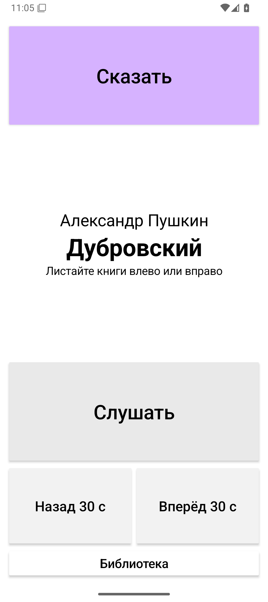
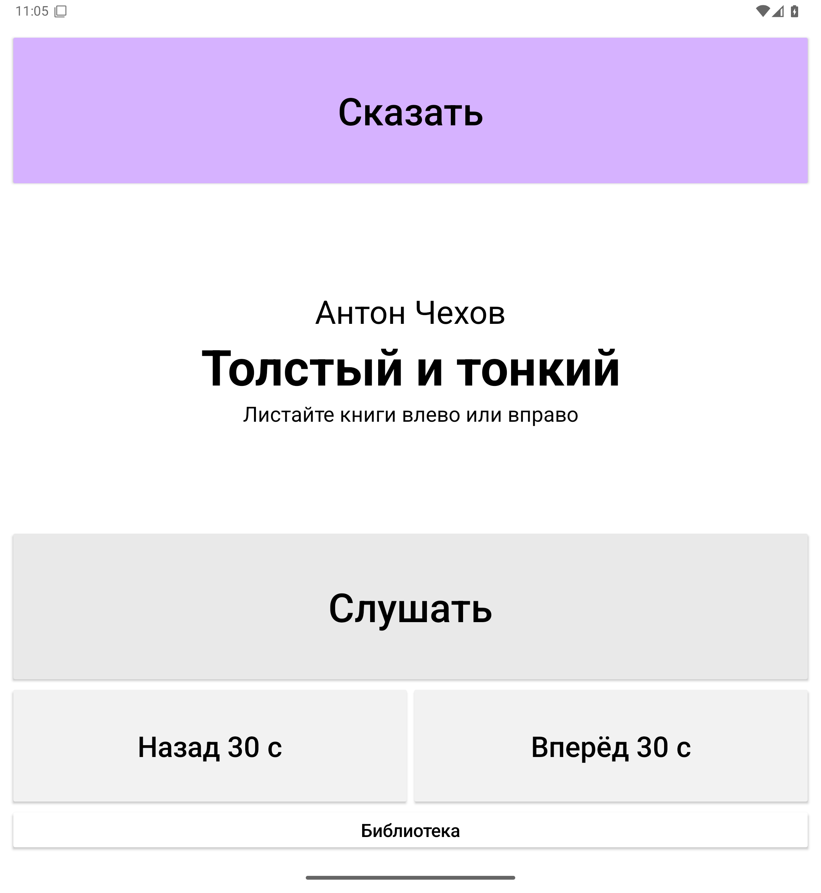
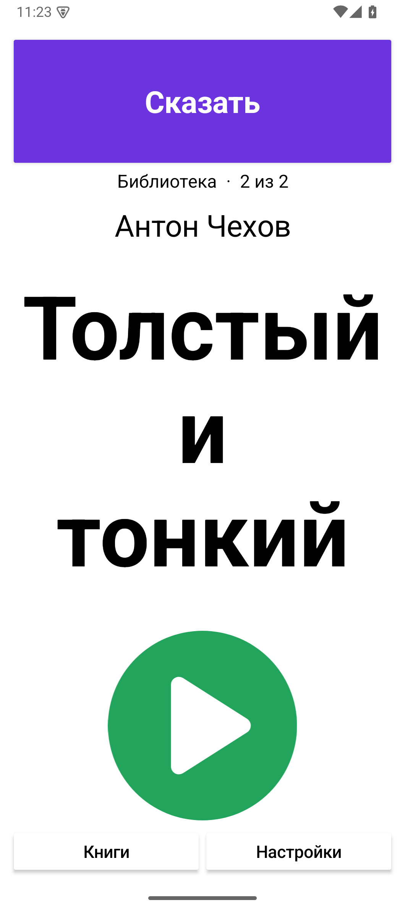

# Слухолист

Android-плеер для слабовидящего слушателя. На обоих экранах HONOR Magic V2 сверху находится фиолетовая кнопка «Сказать», в центре — автор и название, ниже — воспроизведение и перемотка. Один свайп вверх в плеере ставит чтение на паузу и сразу показывает вторую книгу в библиотеке. Если книга одна, показывается она. Свайп вверх листает к следующей, вниз — к предыдущей. Когда карточка остановится, Piper произнесёт автора и название. Зелёная ▶ возвращает в плеер и запускает выбранную книгу с сохранённого места.

**[Скачать установочный APK для Android 9 и новее](https://github.com/Ramnck/slukholist/releases/latest/download/slukholist.apk)**

Откройте скачанный файл на телефоне и нажмите «Установить». Начиная с версии 0.5.1 «Слухолист» устанавливается как отдельное приложение. Если на телефоне есть версия 0.5.0 или более ранняя, обе версии могут стоять рядом. У новой установки свои закладки и настройки.

## Экраны

Снимки с Android 15 в пропорциях внешнего и раскрытого дисплеев HONOR Magic V2.

<p>
  
  
  
</p>

## Как слушать

- При первом запуске доступны две стартовые карточки — «Дубровский» Пушкина и «Толстый и тонкий» Чехова. Рассказ Чехова включён в APK и доступен сразу, даже без интернета. «Дубровский» воспроизводится из сети по главам. После первого прослушивания в карусели появляется история: последняя включённая запись стоит первой. Листание сохраняет этот порядок. Обе стартовые книги доступны через «Книги».
- В меню **Библиотека → Книги → Найти аудиокнигу** введите автора или название. Приложение сначала ищет среди ваших книг, затем в подборке из 21 записи «Культура.РФ». Если совпадений нет, оно параллельно проверяет русские записи LibriVox в Internet Archive и аудиокниги Викисклада. В меню «Об этой записи» указаны источник и сведения об авторстве.
- При воспроизведении из сети плеер загружает текущую часть. Следующая начинает загружаться, когда закончится предыдущая. Для повторного прослушивания плеер хранит до 128 МиБ недавно полученного аудио. Без сети можно слушать в пределах сохранённого фрагмента. При нехватке места Android может очистить кеш.
- Через **Библиотека → Книги → Добавить MP3 или M4B** можно подключить собственную запись, в том числе скачанную покупку. Несколько выбранных файлов становятся главами одной книги в порядке имён. M4B воспроизводится как один файл с запоминанием позиции.
- Стрелки с цифрой 10 перематывают на десять секунд назад и вперёд. Красная кнопка с двумя полосками ставит книгу на паузу.
- На паузе и во время чтения приложение сохраняет главу и позицию внутри записи. При перевороте экраном вниз примерно на секунду плеер ставит книгу на паузу. Поднимите телефон и нажмите зелёную кнопку ▶. Пока приложение открыто, экран остаётся включённым, в том числе во время ответа помощника. При сворачивании или закрытии приложения воспроизведение останавливается. Закладка обновляется каждые две секунды и в момент остановки.
- Для разговора откройте **Библиотека → Настройки**, введите личный ключ DeepSeek и разрешите доступ к микрофону. Нажмите «Сказать» один раз и говорите после вибрации. Например, «Подбери короткий детектив», «А что-нибудь из классики?», «Включи», «Верни мою книгу». Речь отправляется в DeepSeek ASR, текст диалога — в Responses API с веб-поиском. Доступные записи проверяются через каталоги. По окончании ответа микрофон включается для следующей реплики. Повторное нажатие верхней кнопки завершает разговор.
- Помощник может поддерживать разговор на разные темы и проверять сведения в интернете. Для подбора аудиокниг он сначала проверяет библиотеку. На телефоне сохраняются последние десять реплик и короткая заметка о читательских предпочтениях. Для ответа DeepSeek получает этот контекст и названия книг из библиотеки. Уровень размышления — low. Piper произносит «Слушаю», «Принято», «Думаю» и «Ищу» на соответствующих этапах. Микрофон включается после «Слушаю».
- «Сказать» работает и в плеере, и в библиотеке. Попробуйте «Найди Чехова в моей библиотеке», «Следующая», «Включи эту книгу», «Верни мою книгу», «Перемотай назад на двадцать секунд» или «Поставь таймер на пятнадцать минут». Можно попросить открыть настройки или выбор файлов. Ключ вводит владелец телефона, а файлы он выбирает в системном окне Android.
- При сбое приложение показывает причину и произносит её локальным голосом Piper. Если телефон без сети, вы услышите «Нет подключения к интернету». Если у DeepSeek закончились деньги — «На счёте DeepSeek недостаточно денег». Чтобы попробовать снова, нажмите «Сказать».
- Ключ хранится на телефоне в зашифрованном виде с ключом шифрования из Android Keystore. Вызовы DeepSeek тарифицируются на аккаунте владельца ключа. Кнопочное управление, озвучка карточек и импортированные записи работают без ключа.

## Сборка

Требуются JDK 17 и Android SDK с Platform 35 и Build Tools 35.0.0. Поддерживаются Android 9 и новее. В APK входят нативные библиотеки для arm64-v8a и x86_64.

В macOS или Linux (в Windows можно использовать WSL со своей Linux-версией Android SDK) укажите путь к SDK через переменную окружения ANDROID_HOME или sdk.dir в local.properties. Затем выполните команды из корня проекта.

```sh
./scripts/prepare-audio.sh
./gradlew assembleDebug lintDebug
```

Первый скрипт скачивает фиксированную версию sherpa-onnx и голос Piper «Дмитрий», проверяет SHA-256 и готовит ресурсы. Модель и нативные библиотеки включаются в APK во время сборки. Путь к приложению после сборки — `app/build/outputs/apk/debug/app-debug.apk`.

Установка на подключённый телефон с включённой отладкой по USB и запуск тестов на подключённом тестовом устройстве или эмуляторе:

```sh
adb install -r app/build/outputs/apk/debug/app-debug.apk
./gradlew connectedDebugAndroidTest
```

Шаги для проверки на живых записях, включая голосовой поиск, работу в авиарежиме и переход между частями, приведены в [инструкции по тестированию](docs/live-tests.md).

Инструментальные тесты проверяют перемотку и продолжение локальной записи, хранение позиции и озвучку русской фразы через нативный Piper. GitHub Actions собирает отладочный APK при push и pull request и прикладывает его к результатам сборки. Публичный APK имеет идентификатор `ru.slukholist.player`. Для сборки подписанного APK выполните `./gradlew assembleRelease`. Gradle читает `release.p12` (псевдоним `slukholist`) и `password.txt` из каталога `~/.android/slukholist` или из каталога, указанного в `SLUKHOLIST_SIGNING_DIR`. Для последующих обновлений используется тот же релизный ключ. При публикации файл `app/build/outputs/apk/release/app-release.apk` прикладывается к релизу под именем `slukholist.apk`.

## Источники и компоненты

- Подборка [«Аудиобиблиотека. Русская классика XIX века»](https://www.culture.ru/themes/627/audiobiblioteka-russkaya-klassika-xix-veka) содержит записи «Культура.РФ». В APK входят названия, авторы и ссылки на части. Аудио воспроизводится с сервера издателя. Некоторые издания содержат фрагменты произведения.
- Плеер использует [AndroidX Media3 ExoPlayer](https://github.com/androidx/media) для воспроизведения и кеширования.
- [LibriVox](https://librivox.org/) и [Internet Archive](https://archive.org/details/librivoxaudio) предоставляют записи и разбивку на части. Каталог может содержать несколько озвучек одного произведения.
- [Викисклад](https://commons.wikimedia.org/wiki/Category:Audiobooks_in_Russian) указывает лицензию и авторство на странице каждой записи. В приложение включён рассказ [«Толстый и тонкий»](https://commons.wikimedia.org/wiki/Special:Redirect/page/33928834), запись Pogrebnoj-Alexandroff по [CC BY 3.0](https://creativecommons.org/licenses/by/3.0/). Файл взят из опубликованной Викискладом MP3-версии без редактирования. Остальные записи этого каталога воспроизводятся из сети.
- Русская модель [Piper «Дмитрий»](https://k2-fsa.github.io/sherpa/onnx/tts/all/Russian/vits-piper-ru_RU-dmitri-medium.html) работает через [sherpa-onnx](https://github.com/k2-fsa/sherpa-onnx). Карточка модели поставляется в архиве голоса и включается в ресурсы приложения. Для произношения используются данные eSpeak NG из этого архива.
- [DeepSeek ASR](https://api-docs.deepseek.com/guides/asr/) обрабатывает голосовые реплики. [Веб-поиск DeepSeek](https://api-docs.deepseek.com/guides/web_tools/) используется для разговора о книгах.
